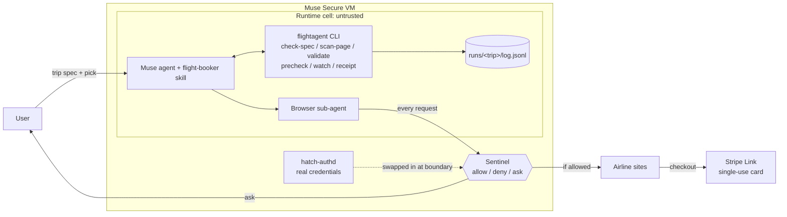

# Architecture

Two layers, each assuming the other can fail.

| Step | Who decides | Command | Stops when |
| --- | --- | --- | --- |
| Spec is sane | code | `check-spec` | bad airports, window, weights; identity data in the file |
| Page is safe to read | code | `scan-page` | agent-directed instructions, fake consent, OTP asks, hidden CSS, zero-width text |
| Option is allowed | code | `validate` | any hard rule breaks; seller not allowlisted or a look-alike |
| Which option | **human** | approval cards | always waits |
| Checkout matches approval | code | `precheck` | price drift over limit, seller/flights/date/travelers changed |
| Money moves | **human** via Muse | platform checkout approval | always asks |
| Fare changes | code | `watch` | reports only, never rebooks |
| What happened | code | `receipt` | n/a |

## Platform layer (Muse)

From Meta's [How We Built Safety Into Muse](https://muse.ai/blog/security-and-safety-for-ai-agents-our-approach-with-muse) (Sep 8, 2026):

- The agent and its tools run in a `systemd-nspawn` runtime cell inside a per-user VM.
- Sentinel, a separate host-side agent, is the sole authority for connector actions and network egress: allow, deny or ask.
- The agent only sees surrogate tokens; Sentinel inserts real credentials at the network boundary.
- "Tainted egress": a process that reads user data loses auto-allow (eBPF-based tracking).
- The browser sub-agent reads an accessibility tree, cannot run page JavaScript, and is backed by injection classifiers.
- Checkout pages trigger a human approval with exact details; Stripe Link issues a single-use card bound to merchant, amount and time.

## Skill layer (this repo)

The platform cannot know a user's travel rules, and a model can be talked out of
them. So the rules live in a CLI with no network access and no dependencies, the
agent must run it, and exit code `2` means stop. The receipt makes every step
reviewable afterwards.

## Known limits

- `scan-page` is a regex tripwire, not a classifier. It complements Muse's
  classifiers; it does not replace them.
- Look-alike detection covers common tricks (brand inside another domain, digit
  swaps, `rn`/`vv`, punycode, `user@host` URLs), not every homoglyph.
- Candidate data is only as good as what the agent extracts from pages. The
  precheck re-reads the live checkout to catch the most expensive mistakes.
